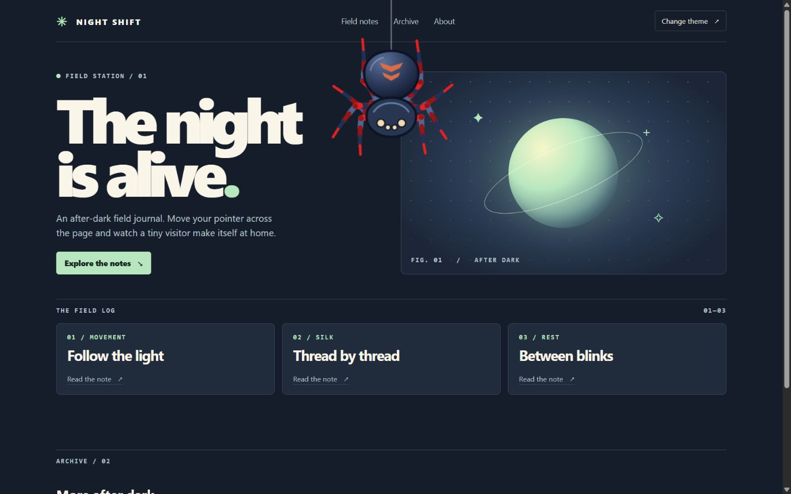
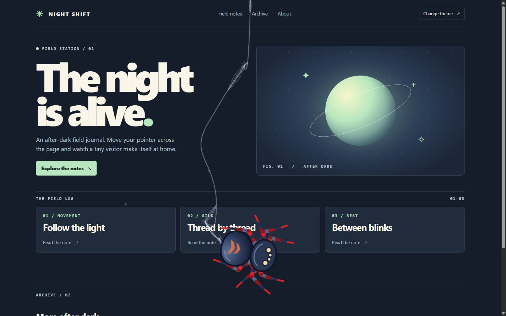
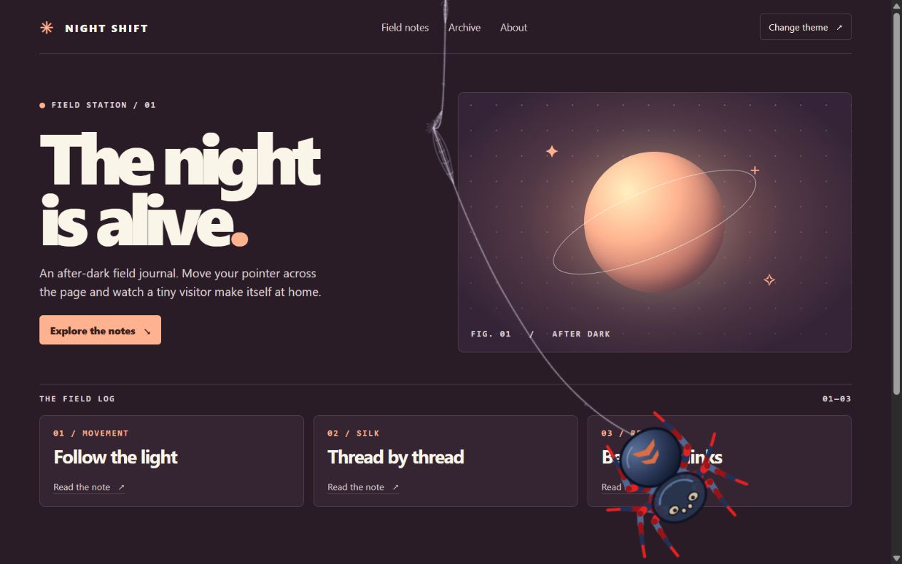

# Spider Overlay

[](https://react.dev/)


A **cursor following spider** for React and vanilla JavaScript sites. The spider descends on a thread, follows your pointer, pounces on clicks, and blinks when idle. Silk catches on elements your page already has.

## Quick start

Install the automatic setup from this feature branch, then add one import to your browser entry file, such as `main.js` or `main.tsx`.

```sh
npm install "git+https://github.com/Vansh2k6/spider-overlay.git#codex/automatic-spider-anchors"
```

```js
import "@vansh2k6/spider-overlay/auto";
```

The import adds the canvas, loads its styles, and finds web anchors. This works in React and vanilla JavaScript projects with a bundler that supports ESM and CSS imports. If you found this by searching for a **Spider URL component**, the install command uses the GitHub URL directly.

## See it on a page



| Silk caught on page elements | Resting on the coral theme |
| --- | --- |
|  |  |

## What happens on your page

- **Move** to let the spider follow your pointer and trail silk. Visible headings, links, buttons, disclosure summaries, and images can catch a strand when it touches their edge. The overlay updates its anchors as content changes or scrolls into view.
- **Click** to make the spider pounce. The canvas lets clicks and text selection through, and the page keeps its native cursor.
- **Press Delete or Backspace** to clear the webs. The keys keep their normal behavior in editable fields.
- **Enable reduced motion** in your system settings to skip the entrance. Pointer interactions remain available.

The overlay uses Canvas 2D and runs in modern browsers with `createImageBitmap` support. On pages with many candidates, up to 48 visible elements can act as automatic anchors at a time.

## Optional controls

Most sites can stop after the quick start. Add one of these attributes when you want to change where silk can attach.

| Attribute | Effect |
| --- | --- |
| `data-web-anchor="edge"` | Marks an element of your choice and catches silk at its edge. |
| `data-web-anchor="center"` | Marks an element and catches silk near its center. |
| `data-web-anchor="none"` | Excludes the element and its descendants. |

Import `requestWebClear()` and `setEffectsHidden(boolean)` from `@vansh2k6/spider-overlay` to connect your own controls. Set the CSS variable `--fx-z-index` to change the overlay’s stacking order.

### Manage the mount yourself

Use this when you need to mount and unmount the overlay with a view. Choose one mount method per page.

```tsx
import { SpiderOverlay } from "@vansh2k6/spider-overlay/react";
import "@vansh2k6/spider-overlay/style.css";

export default function App() {
  return <SpiderOverlay />;
}
```

With vanilla JavaScript, provide a `<canvas id="spider"></canvas>` near the document root.

```js
import { mountSpider } from "@vansh2k6/spider-overlay";
import "@vansh2k6/spider-overlay/style.css";

const canvas = document.querySelector("#spider");
const dispose = canvas ? mountSpider(canvas) : undefined;
// Call dispose?.() before removing the canvas or remounting the overlay.
```

Both manual entry points still discover anchors. Set `automaticAnchors` to `false` to use only marked elements. Add `data-spider-root` to an ancestor of your manual mount to restrict the search to that area. React 19 hosts can also pass `active={false}` to pause the component. Keep the canvas outside transformed containers so it stays fixed to the viewport.

## Build from source

```sh
git clone --branch codex/automatic-spider-anchors https://github.com/Vansh2k6/spider-overlay.git
cd spider-overlay
npm ci
npm pack
```

Builds are checked on Node.js 24. Install the generated `.tgz` in a separate project to test the packaged entry points.

## License

The component source and original spider artwork are available under the [MIT License](LICENSE). The SVGs are the editable originals for the PNG sprites bundled with the package. Runtime dependencies have their own licenses.
